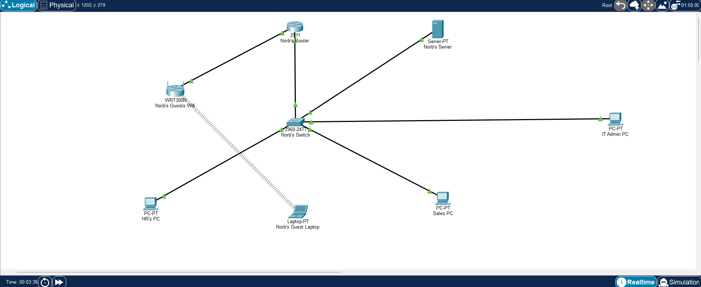

# Network Infrastructure Lab (Cisco Packet Tracer)

## 📌 Project Overview
This repository contains a simulated network infrastructure built using Cisco Packet Tracer. The goal of this project was to design, configure, and troubleshoot a functional network topology, applying core Network Engineering principles.

## 📍 Table of Contents
- [My Current Focus](#-my-current-focus)
- [Featured Projects](#-featured-projects)
- [Tools I am Exploring](#️-tools-i-am-exploring)
- [How to reach me](#-how-to-reach-me)

## 🗺️ Topology Diagram

## 🛠️ Technologies & Concepts Implemented
*   **Routing & Switching:** [Go to Router Configuration](configs/Norbs-Router-running-config.cfg) and [Go to Switch Configuration](docs/Norbetino-Networking-Project.md#22-vlan-and-ip-scheme)
*   **IP Addressing:** [Go to VLAN And IP Schemeing](docs/Norbetino-Networking-Project.md#22-vlan-and-ip-scheme)
*   **Security:** [Go to ACLs](configs/ACLs-summary.txt) and [Go to CLI](configs/CLI-session-log.txt) 
*   **Devices Used:** [Go to Devices](/docs/Norbetino-Networking-Project.md#21-hardware--devices)

## 🎯 Learning Objective
As I transition from Network Engineering into Penetration Testing, understanding how networks are built is critical for understanding how they can be compromised. This lab demonstrates my foundational knowledge of network architecture.

## 🚀 How to Use
1. Download and install Cisco Packet Tracer.
2. Download the `.pkt` file from this repository.
3. Open the file in Packet Tracer to view the configuration, run the simulation, or test connectivity using the command prompt.
4. 📖 **[Click here to read the full Project Write-up](./docs/Norbetino-Networking-Project.md)**
